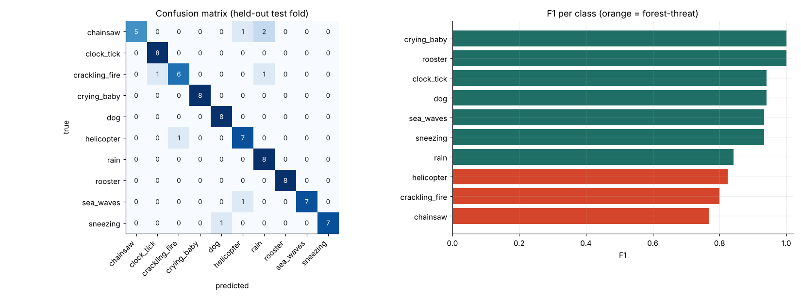

# ForestEar: listening for chainsaws, fire and helicopters in the forest

> **Demo video:** `PASTE YOUTUBE LINK HERE` &nbsp;|&nbsp; **Live app:** `PASTE DEPLOYED URL HERE` &nbsp;|&nbsp; **Repo:** `PASTE GITHUB URL HERE`

African Leadership University · BSE · Machine Learning Pipeline (summative)

## 1. What this project is

Illegal logging, forest fires and low-flying aircraft are hard to spot from the ground in protected forests such as Nyungwe or Gishwati, but they are loud.
**ForestEar** is an end-to-end machine learning pipeline that listens to 5-second sound clips and tells you what it hears among 10 everyday sounds.
Three of them are **forest-threat sounds** (chainsaw, crackling fire, helicopter) and raise an alert.

The data is **audio, not tabular**: the ESC-10 subset of the ESC-50 environmental sound corpus (400 clips, 10 classes, 40 per class).
Audio is converted into log-mel spectrograms and classified by a small CNN (about 223k parameters).

| Required process | Where it lives |
|---|---|
| Data acquisition | `src/data_acquisition.py` (downloads ESC-50 from GitHub, keeps ESC-10, 16 kHz mono) |
| Data processing | `src/preprocessing.py` (decode, resample, fit to 5 s, log-mel, augmentation) |
| Model creation | `src/model.py` + `notebook/forest_ear.ipynb` |
| Model testing | notebook section 5 and `tests/` |
| Retraining + trigger | `src/retrain.py` (button, automatic on new data, automatic on confidence drift) |
| API with Python | `src/api.py` (FastAPI, Swagger at `/docs`) |
| UI | `ui/` (Listen, Insights, Teach and retrain, Monitor) |
| Flood test | `locustfile.py`, `scripts/run_load_tests.sh` |

## 2. Features checklist (assignment's "MUST have" list)

1. **Model prediction for one data point:** Listen tab: upload a clip, record 5 s from the microphone, or click a held-out sample clip. Returns the class, confidence, top-5 candidates, a threat alert, a low-confidence warning and the clip's spectrogram.
2. **Visualizations with interpretation of 3 features:** Insights tab and notebook section 2: spectral centroid (brightness), active fraction (duration) and spectral flatness (tone vs noise), each with a written story generated from the computed numbers, plus a per-class spectrum heat map.
3. **Bulk upload for retraining:** Teach and retrain tab: many `.wav` / `.flac` / `.ogg` files with one label. Files are validated, normalised, saved to `data/uploads/<label>/` and recorded in SQLite.
4. **Trigger retraining:** the *Retrain now* button, or automatically (see section 5). Progress is shown stage by stage, and every run is kept in a history table.
5. **Up-time and monitoring:** Monitor tab shows service up-time, predictions served, requests per minute, median and 95th-percentile latency, a live confidence gauge against the drift threshold, label mix, the model's metrics, a confusion matrix and the list of model versions.

## 3. Quick start

### Run locally
```bash
git clone <this repo> && cd forest_ear
python -m venv .venv && source .venv/bin/activate
pip install -r requirements.txt            # Python 3.11+ ; TensorFlow CPU
python -m uvicorn src.api:app --port 8000  # the trained model and the data are already in the repo
# open http://localhost:8000      (API docs: http://localhost:8000/docs)
```
If `data/train` or `data/test` is missing, run `python -m src.data_acquisition` once (downloads about 650 MB).
To retrain the model from scratch outside the UI: `python -m src.retrain --mode scratch`.

### Run with Docker (and scale it)
```bash
docker compose up --build --scale api=3    # nginx load balancer on http://localhost:8080
```
All replicas share one volume for the model registry, uploads and the SQLite database, so a model retrained by one container is picked up by the others on their next request.

### Notebook
`notebook/forest_ear.ipynb` is saved with its outputs. To re-run it: `pip install -r requirements-dev.txt`, then `jupyter nbconvert --to notebook --execute --inplace notebook/forest_ear.ipynb` (about 25 minutes on one CPU, mostly the hyper-parameter search).

### Tests
```bash
pytest -q                                                       # 15 fast tests
RUN_SLOW=1 NEW_CLASS_DIR=demo_uploads/chirping_birds pytest -q -k retrain   # real retraining with a new class
```

## 4. Model and results

**Input:** 64 mel bands x 126 frames (16 kHz, 5 s). **Network:** 4 conv blocks (batch-norm, ReLU, max-pool, spatial dropout), then global average + max pooling, dropout and a softmax head.

**Splits (official ESC folds, so clips from the same recording never leak):** folds 1-3 train (240 clips), fold 4 validation (80), fold 5 held-out test (80, never used for any decision).

**Optimisation techniques:** L2 regularisation, spatial and dense dropout, batch normalisation, label smoothing, SpecAugment-style augmentation with tunable strength, Adam with ReduceLROnPlateau, early stopping with best-weights restore, and a 6-trial random hyper-parameter search (width, dropout, L2, learning rate, augmentation strength). Selected: filters 24, dropout 0.2, L2 0.0001, lr 0.001, augmentation 0.5.

### Held-out test fold (80 clips)

| Metric | Baseline (vanilla CNN) | **Production model (v1)** |
|---|---|---|
| Accuracy | 0.775 | **0.900** |
| Loss (cross-entropy) | see notebook | 0.423 |
| Precision (macro) | see notebook | 0.914 |
| Recall (macro) | see notebook | 0.900 |
| F1 (macro / weighted) | see notebook | 0.898 / 0.898 |
| Top-2 accuracy | see notebook | 0.925 |
| ROC-AUC (macro, one-vs-rest) | see notebook | 0.993 |

| Class | Precision | Recall | F1 | Clips |
|---|---|---|---|---|
| chainsaw (threat) | 1.00 | 0.62 | 0.77 | 8 |
| clock tick | 0.89 | 1.00 | 0.94 | 8 |
| crackling fire (threat) | 0.86 | 0.75 | 0.80 | 8 |
| crying baby | 1.00 | 1.00 | 1.00 | 8 |
| dog | 0.89 | 1.00 | 0.94 | 8 |
| helicopter (threat) | 0.78 | 0.88 | 0.82 | 8 |
| rain | 0.73 | 1.00 | 0.84 | 8 |
| rooster | 1.00 | 1.00 | 1.00 | 8 |
| sea waves | 1.00 | 0.88 | 0.93 | 8 |
| sneezing | 1.00 | 0.88 | 0.93 | 8 |



**Threat view.** 18 of 24 threat clips were assigned to the correct threat class, and 20 of 24 were flagged as *some* threat. 1 of 56 harmless clips triggered a false threat alert. The most confused pair was chainsaw / rain (2 errors), which matches the feature analysis: both are continuous, noise-like sounds. All other pairs had at most 1 error.

**Honest caveats.** The test fold has only 80 clips, so each clip is 1.25 points of accuracy and results moved by a few points between random seeds in our experiments. An early version of this model with heavier augmentation scored only 68.8%; the final configuration came from the hyper-parameter search plus an ablation of augmentation strength (all in the notebook and commit history). ESC-10 clips come from Freesound; real forest microphones will differ, which is exactly why retraining on uploaded field clips is built in.

## 5. Retraining pipeline

```
upload clips ──► validate + normalise ──► data/uploads/<label>/ + SQLite (uploads table)
                                                │
 trigger: button | >= 20 new clips | confidence drift (+ new clips)
                                                ▼
 preprocess (same code as training) ──► fine-tune the CURRENT model (pre-trained start)
        └─ new class? copy old head rows, fresh row for the new class, train head first, then everything
                                                ▼
 evaluate on the fixed held-out test set ──► promote only if it did not get worse
        same classes: macro-F1 may drop at most 0.03; new class added: old classes may drop at most 0.08 and the new class needs F1 >= 0.60 on its own validation clips
                                                ▼
 models/forestear_v<N>.h5 + registry.json ──► every API container hot-reloads the promoted model
```
Rejected models are still saved and listed as *rejected* in the Versions table, so nothing is lost. A file lock allows only one training job at a time across containers.

**Tested end to end:** uploading the 40 clips in `demo_uploads/chirping_birds/` through the UI triggered an automatic fine-tune (56 s on one CPU). Result: new version promoted, the 10 original sounds kept 87.5% test accuracy (from 90.0%), the new class reached F1 0.73 on its validation clips, and all 8 held-out chirping-bird clips were then recognised.

## 6. Flood-request simulation (Locust)

`locustfile.py` simulates field sensors posting audio clips (10 : 2 : 1 mix of `/api/predict`, `/api/status`, `/health`).

**Measured here (single uvicorn process, 1 vCPU sandbox, 20 simulated users, 40 s, no Docker):**

| Setup | Predict requests | Failures | Req/s | Median | p95 | p99 |
|---|---|---|---|---|---|---|
| 1 process, 1 vCPU | 492 | 0 | 12.6 | 120 ms | 310 ms | 390 ms |

**Docker scaling results (1 to 4 containers): fill in after running on your machine/VM:**
```bash
scripts/run_load_tests.sh 50 10 60s     # writes results/summary.md and results/load_test.png
```

| Containers | Requests | Failures | Req/s | Avg (ms) | p50 (ms) | p95 (ms) | p99 (ms) |
|---|---|---|---|---|---|---|---|
| 1 | | | | | | | |
| 2 | | | | | | | |
| 3 | | | | | | | |
| 4 | | | | | | | |

## 7. API summary (full docs at `/docs`)

| Method and path | Purpose |
|---|---|
| `POST /api/predict` | one clip -> label, confidence, top-5, alert, spectrogram, latency |
| `POST /api/upload` | form field `label` + many `files` -> validated, saved, may auto-retrain |
| `POST /api/retrain?mode=finetune\|scratch` | start training in the background (409 if one is running) |
| `GET /api/retrain/status` | running flag, latest run, history, retrain recommendation |
| `GET /api/status` | up-time, model metrics, traffic and latency, pending uploads |
| `GET /api/model` | all model versions and their metrics |
| `GET /api/insights`, `GET /api/samples`, `GET /health` | dataset insights, demo clips, health check |

## 8. Repository layout
```
forest_ear/
├── README.md
├── notebook/forest_ear.ipynb      executed notebook (preprocessing, training, evaluation, prediction)
├── src/  config.py data_acquisition.py preprocessing.py model.py prediction.py
│         retrain.py db.py insights.py api.py
├── ui/   index.html style.css app.js
├── data/ train/ test/ insights.json     (uploads and the SQLite DB are created at run time)
├── models/ forestear_model.h5 forestear_v1.h5 registry.json
├── demo_uploads/ chirping_birds/ insects/   new-sound clips for the retraining demo
├── tests/  locustfile.py  Dockerfile  docker-compose.yml  nginx.conf  scripts/  docs/
```

## 9. Limits and next steps
* Small dataset (400 clips). Next: a pretrained audio embedding (YAMNet or PANNs), sliding windows over long recordings, on-device inference.
* A closed-set classifier forces every sound into a known class; the low-confidence banner and the Teach tab are the safety net.
* SQLite is fine for a demo; use PostgreSQL for a real multi-node deployment.
* Deployment steps: `docs/DEPLOY.md`. Video script: `docs/VIDEO_SCRIPT.md`.

## Credits
ESC-50 dataset: K. J. Piczak, *ESC: Dataset for Environmental Sound Classification*, ACM Multimedia 2015 (CC BY-NC 4.0; clips originate from Freesound).
